<div align="center">



# Meeting Memo

**Record the meetings you choose. Nothing else.**

A tiny menu-bar app for Mac that watches your calendar for the meetings you picked, offers to record them when
they start, asks to stop when they end, and files each recording under a numbered name. Native Swift,
on-device, nothing uploaded.

[](https://swift.org)
[](#get-started)
[](LICENSE)
[](#status)

</div>

## Features

- **Meetings from your calendar.** In Settings, pick the meetings to record (for example "Psychotherapist").
  Any calendar event whose title contains that text counts.
- **Asks at the right moments.** A card appears in the top-right corner of the screen you're using when a
  chosen meeting starts: its title, "now", who's in it, **Ignore** or **Start Recording** (the chevron offers
  "Remind Me in 5 Minutes" and "Open in Calendar"). Again when it is scheduled to end ("Stop & Save"). While
  a card waits, the menu-bar icon reads "Record?". The menu says when the next card will appear. It never
  records without a click.
- **Notices when you join a call.** When Zoom, Google Meet (or any call in Chrome, Arc, Safari, Edge,
  Brave, Firefox), Teams, Slack, FaceTime, Webex or Discord starts using the mic, a card offers to record,
  even outside the scheduled time. The call's window title is matched to your meetings ("Ari / Yevhenii"
  finds "Yevhenii <> Ari"). A window that names nothing, like Zoom's, uses your meeting on the calendar
  within about an hour. Any other call records under its own title. The chevron offers the other choices.
  When the call ends while recording, it asks to stop. Turn it off in Settings.
- **Mic + call audio.** Records your microphone and the other participants (system audio via
  ScreenCaptureKit) into one `.m4a`. Falls back to mic only if screen-audio access is off.
- **Screen too, per meeting.** Each meeting has its own "Record the screen" switch (say, on for a lecture,
  off for therapy), and the card has a Screen switch to change it right before you start; the card's choice
  is remembered for that meeting. Quick recordings and unmatched calls follow Settings → Recording. The
  video (`.mov`, HEVC, 30 fps, with call audio and mic) is saved next to the `.m4a`, from the main display
  or the one you pick (falling back to the main one if it's unplugged). The app's own card stays out of it.
- **Saved, with a quick way out.** After you stop, a small card says "Saved" with the length and what was
  kept: **Show in Finder**, **Open**, or **Delete** (a second click confirms; it moves the audio, video and
  transcript to the Trash and gives the number back). It closes by itself after 10 s, or stays while the
  pointer is on it.
- **Transcripts that stay on your Mac.** Each recording is transcribed with Whisper large-v3-turbo on
  Apple Silicon (MLX, run through `uv`) and saved as a `.md` with the same name next to it: title, meeting,
  date, length, language and a `[mm:ss]` transcript. The audio never leaves the Mac; once the model is
  downloaded (1.6 GB, once) the run is fully offline. Turn it off in Settings → Recording.
- **Numbered names.** `Psychotherapist #2 — 2026-10-27 08.00.m4a`, numbered per meeting, saved to
  `~/Documents/Meeting Recordings` (or a folder you choose).
- **Menu bar.** A small waveform; while recording, a dot and a fixed-width timer that doesn't nudge the
  icons next to it. The menu lists each meeting with its next date and time, soonest first: click the name to start recording,
  click the date to open the event in Calendar. Quick recording for anything else. The last saved file is
  one click from Finder.
- Launch at login, optional lead time before the meeting, "Now · until 9:00 AM" while a meeting is on.

## Get started

```bash
brew install xcodegen
git clone https://github.com/vekaev/meeting-memo && cd meeting-memo
scripts/install-mac.sh      # build, install to ~/Applications, open
```

The first time, macOS asks for Calendar, Microphone and Screen & System Audio Recording access.
`scripts/build-app.sh` builds a universal `dist/MeetingMemo-mac.dmg`.

## Privacy

Everything stays on your Mac: recordings go to the folder you chose, settings to
`~/Library/Application Support/MeetingMemo/settings.json`. No network access, no analytics.
Recording other people may require their consent where you live; Meeting Memo leaves that to you.

## Status

Early, used daily by its author. Issues and ideas welcome.

## License

MIT
